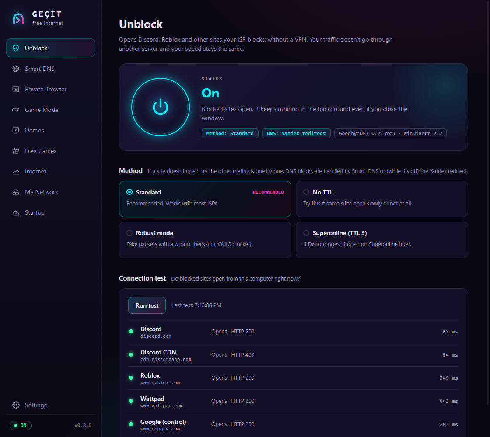
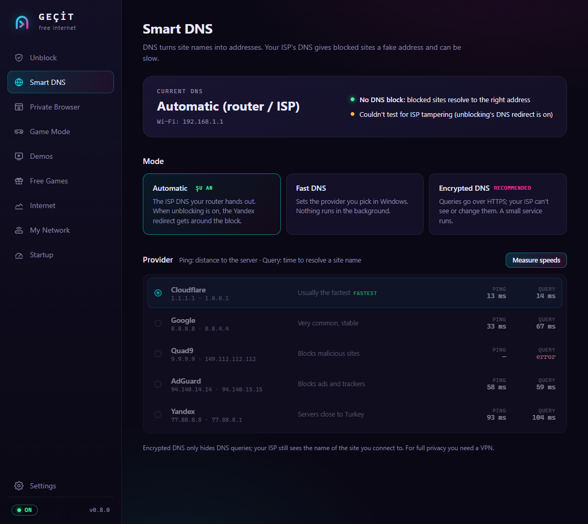
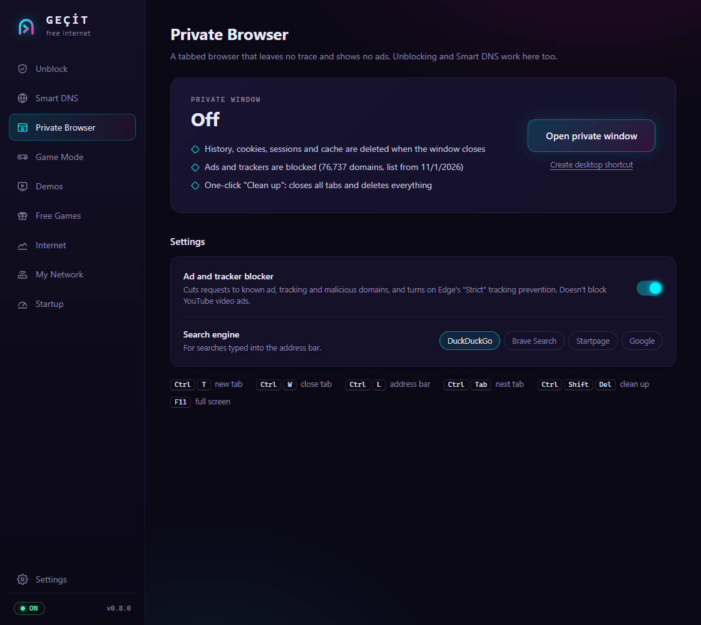
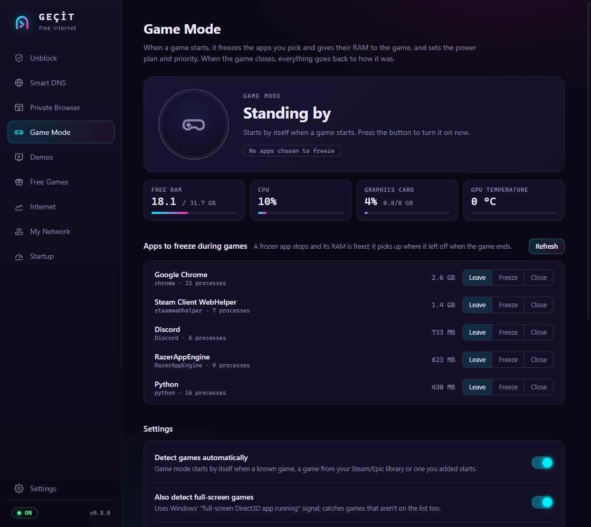
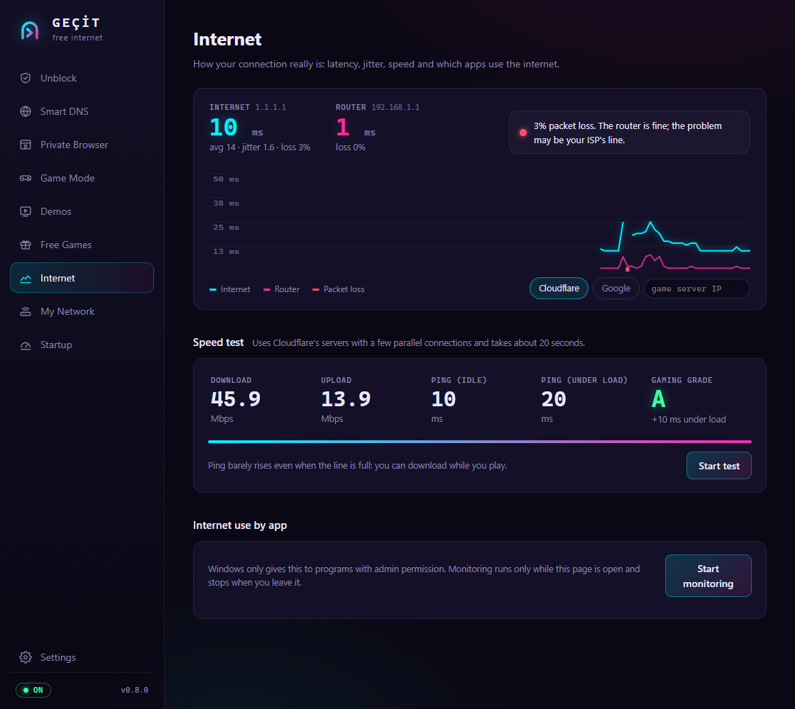
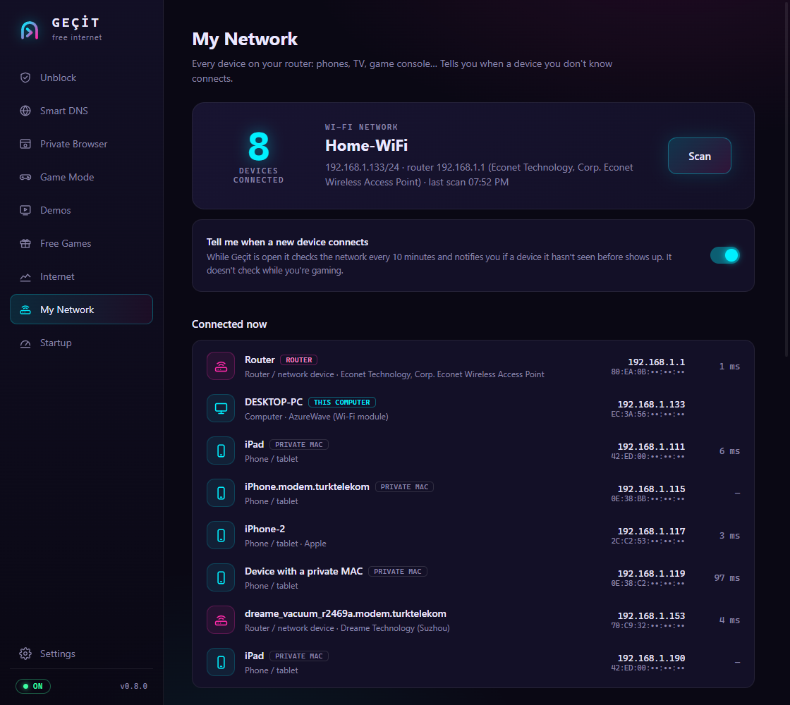
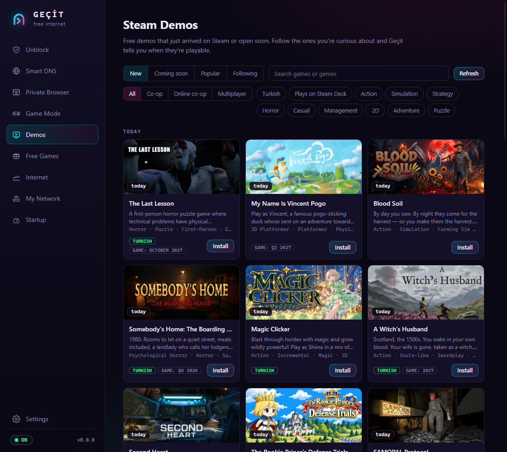
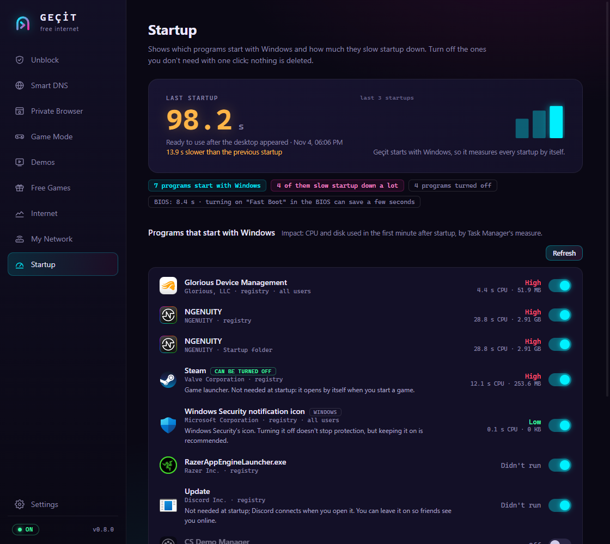

<p align="right"><b>English</b> | <a href="README.tr.md">Türkçe</a></p>

# Geçit

An all-in-one Windows app that starts with your PC and helps you get the most out of your internet and your computer.

It opens blocked sites like Discord and Roblox without a VPN, speeds up and encrypts your DNS, freezes background programs while you play, and shows what is going on with your internet connection and your home network. It also keeps track of new Steam demos and the games Epic and Steam are giving away for free.

<p align="center">
  <a href="../../releases/latest"></a>
  <a href="../../releases"></a>
  <a href="LICENSE"></a>
  
</p>

<p align="center">
  <a href="../../releases/latest"><b>⬇ Download Geçit (Windows 10/11)</b></a>
</p>

> *Geçit* (pronounced "geh-chit") is Turkish for "passage" or "mountain pass". The app is available in English and Turkish.

## What does it do?

### 🛡️ Unblock
Opens sites blocked by your ISP (Discord, Roblox, Wattpad…) with **one click**. It is not a VPN: your traffic does not go through anyone else's server, so your speed does not drop. If a site still won't open, you can try a different method with one click, and the "Connection test" shows which sites open. It keeps working in the background after you close the window.

The unblocking methods are tuned for ISPs in Turkey (built on [GoodbyeDPI-Turkey](https://github.com/cagritaskn/GoodbyeDPI-Turkey)). Everything else in Geçit works anywhere.



<table>
<tr>
<td width="50%" valign="top">

### 🌐 Smart DNS
**Measures the speed** of DNS providers (Cloudflare, Google, Quad9…) **on your own connection** and suggests the fastest. It tells you whether your ISP blocks sites through DNS. With **Encrypted DNS**, queries go over HTTPS, so your ISP can neither see nor change which sites you look up.

</td>
<td width="50%" valign="top">

### 🕶️ Private Browser
A tabbed browser that **leaves no trace**. When the window closes, history, cookies and sessions are deleted. About 74 thousand ad and tracker domains are blocked. Unblock and Smart DNS work here too. It can have its own desktop shortcut.

</td>
</tr>
<tr>
<td></td>
<td></td>
</tr>
<tr>
<td width="50%" valign="top">

### 🎮 Game Mode
Turns on by itself when a game starts. It **freezes** the programs you pick (Chrome, Discord…) and hands their RAM to the game, switches to the high performance power plan, and gives the game priority. When the game closes, everything picks up where it left off. Shows live RAM, CPU, GPU usage and GPU temperature. No fake "FPS boost".

</td>
<td width="50%" valign="top">

### 📈 Internet
A second-by-second **ping graph**, both to the internet and to your router, so you know whether the problem is your home network or your ISP. The **speed test** gives a gaming grade (bufferbloat) next to download and upload speed. It also shows how much each app is using your internet.

</td>
</tr>
<tr>
<td></td>
<td></td>
</tr>
<tr>
<td width="50%" valign="top">

### 📡 My Network
Lists **every device** on your router: phones, TVs, computers… Finds the maker and, where it can, the model (e.g. "Samsung 7 Series"). Shows a notification when **a device you don't know joins** your network. You can give devices your own names.

</td>
<td width="50%" valign="top">

### 🕹️ Demos
**New, upcoming and popular** free demos on Steam. There is a **co-op / online co-op** filter for playing with friends, plus Turkish-language and Steam Deck tags. Follow a demo you're curious about and Geçit tells you when it becomes playable.

</td>
</tr>
<tr>
<td></td>
<td></td>
</tr>
<tr>
<td width="50%" valign="top">

### 🎁 Free Games
The games Epic and Steam are **giving away right now** and the time left. Claim one before time runs out and it stays in your account forever. Epic's game for next week shows up in advance too. You get a notification when a new giveaway starts.

</td>
<td width="50%" valign="top">

### ⚡ Startup
Shows the programs that start with Windows and **how much each one slows down boot**. Turn off the ones you don't need with one click; nothing is deleted. It marks programs registered twice and the ones that are safe to turn off, and measures your boot time.

</td>
</tr>
<tr>
<td></td>
<td></td>
</tr>
</table>

### 🔄 And more
- **Updates**: when a new version is out, it installs from inside the app with one click (the file's checksum is verified).
- **System tray**: can start with Windows and runs quietly in the background.
- **Administrator rights** are asked for only when installing the services; the app itself runs as a normal user.
- **Clean uninstall**: your DNS settings go back to what they were, and the services and driver are removed.
- **Two languages**: English and Turkish. Follows your Windows language by default; you can change it in Settings.

> The screenshots were taken with v0.8.0 on a Türk Telekom Wi-Fi connection. On the My Network screen, personal device names were replaced and the second half of each MAC address is hidden.

### Version history

| Feature | Version |
|---|---|
| Unblock (GoodbyeDPI-Turkey) | v0.1 |
| Smart DNS (fast DNS, encrypted DNS / DoH) | v0.2 |
| Private Browser | v0.3 |
| Game Mode | v0.4 |
| Internet (ping, speed test, per-app traffic) | v0.5 |
| My Network, Startup, in-app updates | v0.6 |
| Demos, Free Games | v0.7 |
| English interface | v0.8 |

## Download

Download `Gecit-Setup-<version>.exe` from the [**Releases**](../../releases/latest) page and run it. Requires Windows 10 (1809+) or 11, 64-bit. You don't need to install .NET.

- The installer is not code-signed, so Windows may say "Windows protected your PC": click **More info → Run anyway**.
- Some antivirus programs (e.g. Kaspersky) may block the WinDivert driver that GoodbyeDPI uses. The driver is signed and open source; see the verification notes below.
- To uninstall: Settings → Apps → Geçit. Your DNS settings are restored, and the services and driver are removed.

## Building

Requirements: .NET 10 SDK, WebView2 Runtime (usually already installed on Windows 10/11).

```powershell
dotnet build
.\src\Gecit\bin\Debug\net10.0-windows\win-x64\Gecit.exe
```

## Installer

```powershell
winget install JRSoftware.InnoSetup   # once
pwsh installer\build.ps1              # -> dist\Gecit-Setup-<version>.exe
```

- `dotnet publish` runs self-contained, so users don't need .NET. The package is about 38 MB (about 120 MB installed). The version number comes from `<Version>` in `src\Gecit\Gecit.csproj`.
- The app installs to `C:\Program Files\Gecit`. The folder can't be changed, because the services run `Gecit.exe` from there: `GecitDNS` = `Gecit.exe --dns-service <provider>`, `GecitDPI` = `dpi\goodbyedpi.exe`. A development build copies itself into this folder when it runs (`AppInstall.EnsureInstalledCopy`).
- If WebView2 is missing, Microsoft's bootstrapper installs it silently.
- Updating: the installer closes the running app cleanly with `Gecit.exe --exit` (game mode ends, frozen programs are resumed). It then stops the GecitDNS/GecitDPI services and the WinDivert driver with `sc`. After the files are replaced, `--elevated resume-services` restarts whatever was running before.
- Uninstalling: runs `--elevated uninstall --full`. DNS is restored, the services and driver are removed, and the start-with-Windows entry is deleted. Then the folder, shortcuts, `%LOCALAPPDATA%\Gecit` and `%ProgramData%\Gecit` are deleted. User settings (`%APPDATA%\Gecit`) are kept. Verified on 2026-10-26 with a silent install, uninstall and reinstall.
- The package is not code-signed, so SmartScreen shows a "Windows protected your PC" warning. The information page in the installer (`installer\notice-en.txt`, `installer\notice-tr.txt`) explains this and that Geçit is not a VPN.
- The encrypted DNS service logs to `%ProgramData%\Gecit\dns.log`. If the service fails its check, the last lines are added to the error message.

## How it works

```
Gecit.exe (normal user)                 Gecit.exe --elevated install <method>   (only during setup, UAC)
 ├─ WinForms window + WebView2           ├─ dpi\ → C:\Program Files\Gecit\dpi\
 │   └─ wwwroot/ (HTML/CSS/JS UI)        ├─ sc create GecitDPI  (start=demand)
 ├─ system tray icon                     └─ sc sdset: interactive user may only start/stop
 └─ start/stop the GecitDPI service
        └─ goodbyedpi.exe → WinDivert64.sys
```

- The app runs **without administrator rights**. Admin rights are asked for only when installing the service, changing the method, and uninstalling.
- Because the service runs as SYSTEM, its files are copied under `Program Files`, where users can't change them. Users are **not** given permission to change the service's configuration, only to start and stop it; otherwise it would be a privilege escalation hole.
- "On" means the service is running **and** the WinDivert driver is loaded. goodbyedpi reports "running" before the driver is opened.
- Settings: `%APPDATA%\Gecit\settings.json`. Start with Windows: `HKCU\...\Run\Gecit` (`--tray`).

### Smart DNS

| Mode | What it does |
|---|---|
| Automatic | Your router's/ISP's DNS (the setting from before Geçit is restored). While Unblock is on, GoodbyeDPI's Yandex redirect gets around DNS blocking. |
| Fast DNS | Writes the chosen provider's addresses to the adapters connected to the internet (`netsh`). Nothing runs in the background. |
| Encrypted DNS | The `GecitDNS` service (`Gecit.exe --dns-service`, code in `src/Gecit.Dns`, running as LocalService) listens on 127.0.0.1:53 and [::1]:53 and forwards queries over RFC 8484 DoH. The system DNS becomes 127.0.0.1 / ::1. |

- GoodbyeDPI's Yandex DNS redirect is turned off while Smart DNS is on; otherwise it would override the DNS the user picked. The methods (Standard, No TTL, Robust, TTL 3) are independent of this.
- Safety order: the system DNS is switched to 127.0.0.1 only **after** the DoH service has answered a real query. It is also switched to another address **before** the service is removed. So there is never a moment without DNS.
- DoH fallbacks: chosen provider → Cloudflare/Google/Quad9 → plain UDP as a last resort. If DoH breaks completely, privacy drops but the internet keeps working. If the service crashes, Windows restarts it 3 times, and the app also tries to start it (users can start it but not stop it).
- The DNS settings from before the first change are backed up to `C:\Program Files\Gecit\dns-backup.json`. They are restored when you go back to Automatic and by "Remove Geçit from the system".
- Testing: `Gecit.Dns.exe cloudflare --console --port 5454` (5353 belongs to mDNS, don't use it). For a single query: `Gecit.Dns.exe quad9 --query discord.com`. Note: Windows `nslookup` ignores `-port=` and queries port 53.

Measured on this connection (Türk Telekom, 2026-10-26): the ISP resolves blocked names to 195.175.254.2, but does not touch port 53 traffic going to other servers. So Fast DNS also gets around DNS blocking. DoH query times: Google ~54 ms, AdGuard ~56, Cloudflare ~61, Quad9 ~64, Yandex ~113.

### Private Browser

- `BrowserForm`: an HTML toolbar on top (`wwwroot/browser/chrome.html`), with one WebView2 per tab below it. All tabs share a single **InPrivate** profile (`gecit-private`). WebView2 deletes this profile's data when the last tab closes; "Clear" also calls `ClearBrowsingDataAsync`.
- Ad/tracker blocking: Edge tracking prevention set to "Strict" + `AdBlocker` (StevenBlack unified hosts, about 74 thousand domains, `%LOCALAPPDATA%\Gecit\blocklist-hosts.txt`, refreshed weekly). It matches the domain and all of its parent domains. Blocked requests are cut off with a 403 in `WebResourceRequested`. The main page the user opens is never blocked.
- Pop-ups are given real tabs (`NewWindow`), so `window.opener` flows like "Sign in with Google" work.
- Because the toolbar page can send commands to C#, data coming from pages (titles etc.) is written there only with `textContent`.
- `Gecit.exe --browser` opens the browser directly (the desktop shortcut uses this). If the app is already open, it gets a signal instead.

### Game Mode

- Detection (every 2 seconds): a built-in list (`GameCatalog.Known`, including Metin2/Knight Online/Zula, which are popular in Turkey), Steam libraries (`libraryfolders.vdf` + `appmanifest_*.acf`), Epic manifests, .exe files the user added, and optionally `SHQueryUserNotificationState == QUNS_RUNNING_D3D_FULL_SCREEN`.
- When a game starts:
  - It switches to the high performance power plan (`powercfg`, no admin needed).
  - The game gets high priority.
  - The chosen apps are either **frozen** (`NtSuspendProcess` + `EmptyWorkingSet`: CPU drops to zero, RAM goes to the page file, and they pick up where they left off) or **closed** (`CloseMainWindow`, nothing is force-killed; they are reopened when the game ends).
- When the game process closes, all of this is undone. If the user changed the power plan themselves during the game, it is left alone. Resuming checks the start time along with the PID, so a different process that got the same PID is never touched.
- Crash safety: the session is written to `%LOCALAPPDATA%\Gecit\gamemode-session.json` before anything is touched. If Geçit crashes, frozen apps are resumed and the power plan is restored on the next start (verified in testing).
- Nothing is injected into the game itself; only its priority is changed. If the anti-cheat doesn't allow that, a note is shown.
- Live panel: RAM, CPU (`GetSystemTimes`), GPU usage, VRAM and temperature (`nvidia-smi`). The session report includes the RAM freed and the highest GPU temperature.

### Internet

- Live connection: an internet target (Cloudflare, Google or a game server the user types in) and the default gateway (router) are pinged over ICMP once a second. The last 120 seconds are drawn on the graph. Average, jitter (difference between consecutive pings) and loss are calculated. Diagnosis: if the router ping is bad, the problem is in your home network (Wi-Fi/cable); if the router is fine but the internet is bad, the problem is with your ISP. The loop runs only while the page is open and stops on its own if no request comes in for 6 seconds.
- Speed test: 6 parallel downloads and 4 parallel uploads via `speed.cloudflare.com`, 8 seconds each. The first 1.5 seconds are TCP slow start, so they are left out of the measurement. 1.1.1.1 is pinged during the test, and the bufferbloat grade comes from how much latency rises (A+ <5 ms, A <30, B <60, C <200, D <400, F). Cloudflare returns 403 for download requests larger than 50 MB.
- Per-app traffic: Windows opens the kernel ETW session only to administrators. So the `Gecit.exe --elevated netmon <pipe> <uiPid>` helper process (TraceEvent, `NetworkTCPIP | Process`) writes bytes per PID to a named pipe once a second. The helper exits when the UI closes the pipe or exits itself (verified in testing). Process names are taken when a packet is first seen; for processes that have exited, the file name from ProcessStart/DCStart events is used.

Measured on this connection (2026-10-26, Ethernet): 53 ms to Cloudflare, ~1 ms to the router, 620 Mbps download, 47.8 Mbps upload, +5 ms under load → grade A.

### My Network

- No admin rights needed. `LanScanner` pings the 254 addresses on its own /24 network twice. Devices that don't answer pings still end up in the ARP table (`GetIpNetTable`), because they answer Windows' ARP request. IP and MAC come from there.
- Names are looked up in this order, all in parallel:
  - The device's own interface: Samsung TV `:8001/api/v2/`, Chromecast/Google TV `:8008/setup/eureka_info`, Roku `:8060/query/device-info`. All are read-only and don't ask for pairing.
  - UPnP/SSDP description: `friendlyName`, manufacturer and model. Routers' generic "Internet Home Gateway Device" name is skipped; the router always shows as "Router".
  - An mDNS PTR query to the device itself (5353), NetBIOS node status, and a PTR record in the router's DNS.
- The maker is found from the first half of the MAC (OUI). The data comes from the embedded `Assets/oui.txt.gz` (58 thousand entries, 540 KB). `tools/build-oui.ps1` rebuilds this file from Wireshark's copy of the IEEE registry. Phones' "private MAC" addresses (locally administered bit) have no maker; these are guessed to be phones/tablets.
- Devices seen are stored per network in `%APPDATA%\Gecit\devices.json`. Networks are told apart by the router's MAC, so a laptop moving to another network doesn't raise false "new device" alerts. The first scan is taken as the baseline. Devices that show up later carry a "new" tag for a day, and a notification is shown by the background check (every 10 minutes, not during games).
- On this network (2026-10-26): a Nokia router (made by Taicang T&W), 7 devices. The Samsung TV was recognized as "Samsung 7 Series (43)" through its own API while it was on. The router doesn't pass mDNS multicast between Wi-Fi and cable, which is why the phones' names don't show up.

### Startup

- The list is the same as Task Manager's Startup tab: HKCU/HKLM `Run`, `WOW6432Node\Run` and the two Startup folders. Turning items on/off writes the `Explorer\StartupApproved` value that Task Manager uses: 12 bytes, first byte `02` on, `03` off (followed by the time it was turned off). No entry is ever deleted.
- Items for all users (HKLM) are changed with `Gecit.exe --elevated startup <source> <name> on|off`. The helper only writes to items that actually exist and refuses user items.
- Measurement (`BootMeter`): Windows' own boot log is only open to administrators, so Geçit measures boot itself. The starting point is when explorer.exe starts (when the desktop appears). The PC counts as "ready to use" once CPU drops below 25% and disk below 30% and stays there for 5 seconds. This is measured for up to 3 minutes.
- Per-program impact is calculated 75 seconds after the desktop appears. For processes matching the item's exe that started after sign-in, including their child processes, CPU time (`GetProcessTimes`) and I/O bytes (`GetProcessIoCounters`) are added up. The thresholds are Task Manager's: high >1 s CPU or >3 MB, medium >300 ms or >300 KB.
- If Geçit starts with Windows, it measures on every boot by itself. If it doesn't, the "Measure on next boot" button writes a one-time `Gecit.exe --boot-measure` under `HKCU\...\RunOnce`. This command measures without opening a window, reports the result with a notification and exits. The last 12 measurements are kept in `%LOCALAPPDATA%\Gecit\boot-history.json`. BIOS time is the `FwPOSTTime` value Windows records.
- In a development build, the `GECIT_DESKTOP_AGO=<sec>` environment variable starts a measurement as if the desktop had appeared that many seconds ago, so it can be tested without rebooting. Verified: per-process CPU times match `Get-Process`.

### Updates

- `Updater` checks `api.github.com/repos/Furkan-Erg/Gecit/releases/latest` 10 seconds after start (90 seconds if the session was just signed in) and every 12 hours. It can be turned off in Settings.
- Only a file named `Gecit-Setup-*.exe` with a `sha256:` digest computed by GitHub is offered. The file is downloaded to `%LOCALAPPDATA%\Gecit\update`. Its checksum is checked while the file is held open with a read-only lock, and the installer is started under that lock, so the file can't be swapped between the check and the run.
- The installer is started with `/SILENT /RELAUNCH=show|tray` **without `runas`**. Inno elevates itself and remembers the normal user, so the relaunched Geçit isn't running as admin. Started with `runas`, the new Geçit would have opened as admin; this was seen in testing and fixed. The installer closes the old Geçit with `--exit`. It stops the services, replaces the files, restarts the services and reopens the app.
- The installer's `taskkill` only touches user sessions (`SESSION ne 0`). The `Gecit.exe` in session 0 is the GecitDNS service and is stopped cleanly.
- For testing, the `GECIT_UPDATE_URL` environment variable points a development build to a fake release address. Tests done on 2026-10-26:
  - A tampered checksum was rejected and the installer didn't run.
  - A real update took 14 seconds. The services restarted and Geçit reopened without admin rights.

### Demos and Free Games

- No API key or account needed; Steam's and Epic's public store data is used (`src/Gecit/Store`).
- Demos: the order comes from Steam store search (`category1=10`; new = `sort_by=Released_DESC`, upcoming = `filter=comingsoon`, player filter = `category3`: 9 co-op, 38 online co-op, 1 multiplayer). Details (image, tags, language support, Steam Deck compatibility, release date) are fetched with `IStoreBrowseService/GetItems` for both the demo and the main game.
- Followed demos are checked every 2 hours, or every 10 minutes if an announced time has passed. If the developer changes the date, the saved date is updated too.
- Free Games: campaigns in Epic's `freeGamesPromotions` data whose price drops to 0% (this week and next). On Steam, discounted items are sorted by price and the ones with `best_purchase_option.is_free_to_keep` are kept. Free-to-play games and free weekends are left out because they aren't yours to keep.
- New giveaways are checked every 3 hours, or every 10 minutes around the start and end of a campaign. No notifications for DLC.

## Third-party files

`third_party/goodbyedpi/` contains the x86_64 files of [GoodbyeDPI-Turkey](https://github.com/cagritaskn/GoodbyeDPI-Turkey) release `release-0.2.3rc3-turkey`. Verified on 2026-10-26:

| File | SHA-256 | Note |
|---|---|---|
| goodbyedpi.exe | `8d412b09…c430dd1f` | Imports only WinDivert, CryptGenRandom, the service API, the CRT and ws2_32. No network client, no process launching, no registry writes. Strings match the 0.2.3rc3 source exactly. |
| WinDivert.dll | `6110bfa4…5e6c7e` | Identical to the official WinDivert 2.2.0-C. |
| WinDivert64.sys | `e69b5ba3…e82cf50` | Version 2.2.0-D, valid Cloudveil Technology signature. |

Windows Defender flags WinDivert 2.2.2 as `Misleading:Win32/Malgent!AMTB` but not 2.2.0. That is why 2.2.0 is used.

Licenses are in `third_party/goodbyedpi/licenses/`: GoodbyeDPI Apache 2.0, WinDivert LGPLv3.

`src/Gecit/Assets/oui.txt.gz`: derived from the IEEE MAC address block registry (MA-L/MA-M/MA-S). Wireshark's `manuf` copy is used as the source; the file is generated with `tools/build-oui.ps1`.

## License

Geçit's own code is licensed under [GPL-3.0](LICENSE). Third-party files come with their own licenses (above).

## Disclaimer

Geçit is not a VPN. It does not hide your identity; it only gets around your ISP's DPI and DNS blocks. You are responsible for how you use it.
